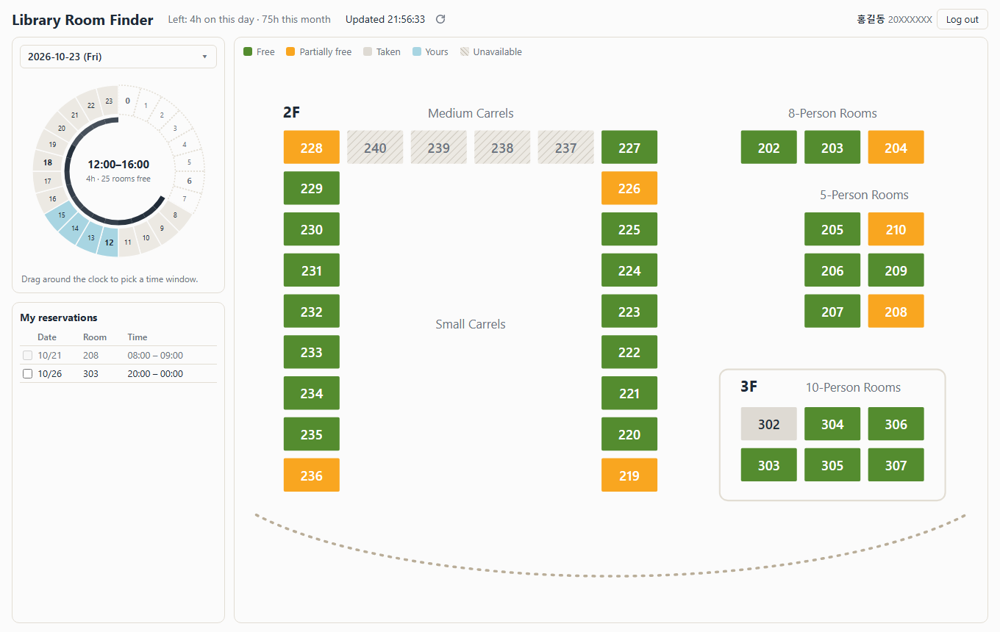
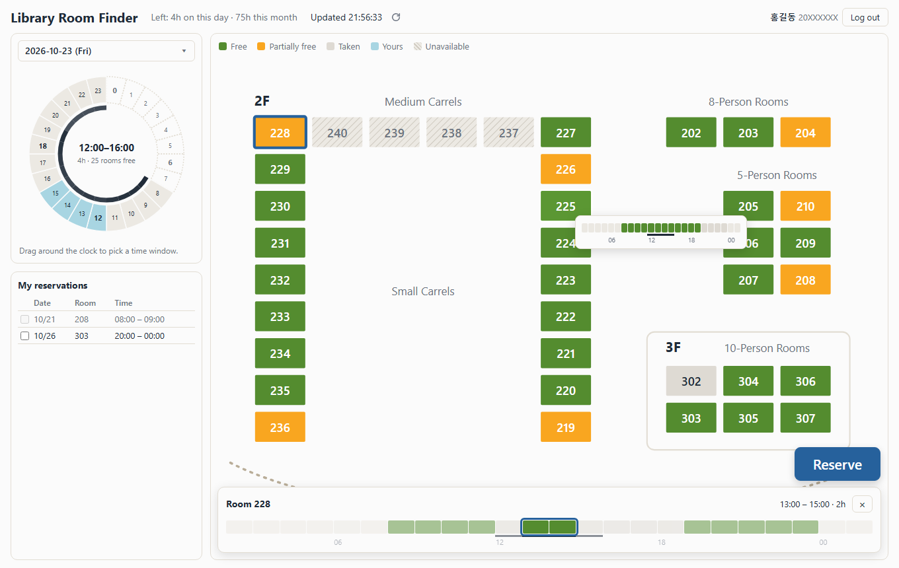
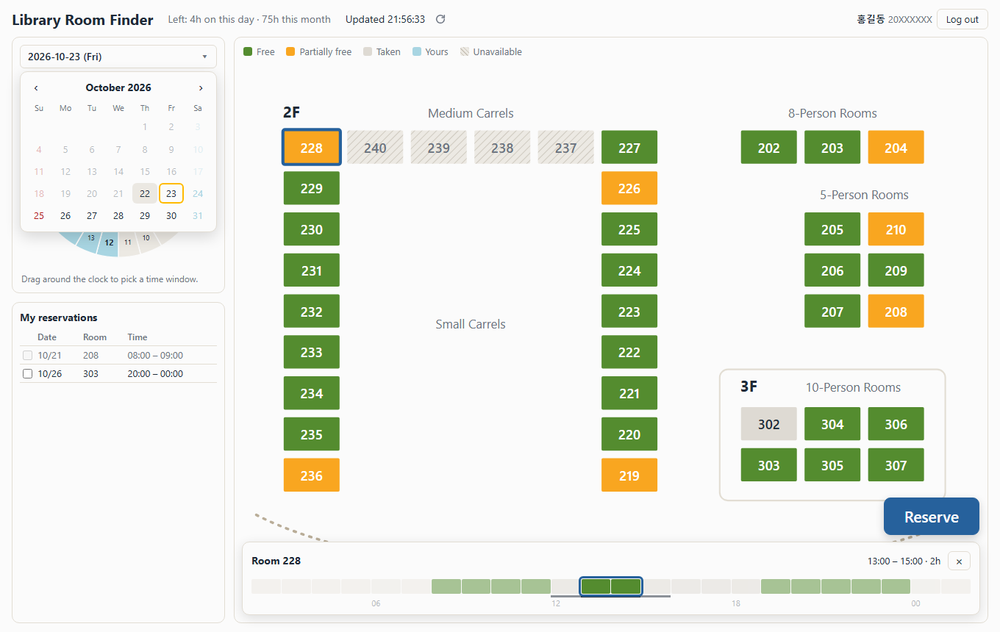
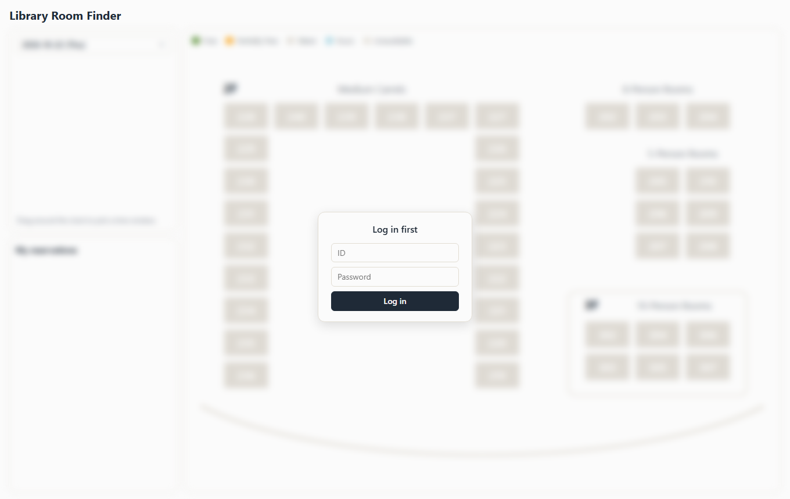

# Library Room Finder

An alternative view of the [GIST Library facility reservation](https://library.gist.ac.kr/#/facilityReservation) page.

The official page makes you pick one room from a dropdown and read its calendar, room by room. This app turns that around: **pick a time window, and the floor map shows which rooms are free for it.** You can then book (and cancel) straight from the map.



## Features

- **Floor map of 2F and 3F.** An abstract map of every reservable room (group study rooms, carrels), coloured for the selected window:
  free, partly free, taken, yours, or not bookable for your account.
- **24-hour clock picker.** Drag around the ring to choose a time window. A dark inner arc shows how many rooms are free each hour.
  The library's 00:00–02:00 slots count as the end of the evening before, so a window can run across midnight (e.g. 22:00–02:00).
- **Hover tooltip.** A one-line heatmap of the room's whole day.
- **Click to book.** Clicking a room opens its day strip with a pre-selected bookable stretch that fits your daily and monthly quota.
  Adjust it by dragging (Shift+click extends, Ctrl/⌘+click adds or removes hours), then press **Reserve**.
- **My reservations.** Your bookings this month. Tick rows and press **Cancel** to cancel several at once.
- **Near-live data.** Refreshes in the background every minute, with a manual refresh button (see [Going easy on the library's server](#going-easy-on-the-librarys-server)).
- **Per-tab login.** You log in with your own library account; the session ends when the tab is closed.
- **No backend needed.** The page talks to the library's API from your browser, so it can be hosted on GitHub Pages.



| Date picker | Login |
| --- | --- |
|  |  |

## Running it

### On GitHub Pages

The repository includes a workflow ([.github/workflows/pages.yml](.github/workflows/pages.yml)) that publishes `static/`
on every push to `main`. Turn it on once under **Settings → Pages → Source: GitHub Actions**; the site then appears at
`https://<user>.github.io/<repo>/`.

### Locally

Requires Python 3.8 or newer. No packages to install; it uses only the standard library.

```sh
python server.py
```

Then open <http://localhost:8000> and log in with your GIST library ID and password.
To use another port, create a `.env` file next to `server.py` containing `PORT=8080`.

On localhost the page sends its library calls through `server.py`, so the local version keeps working even if the library
ever stops accepting calls from other websites.

## How it works

[`static/library.js`](static/library.js) talks to the library's own JSON API (`https://library.gist.ac.kr:8443`)
directly from the browser, using the same calls the official site makes:

| Library endpoint | Used for |
| --- | --- |
| `/hello/login`, `/hello/getAccount` | Log in, read your name and account flags |
| `/work/getFacilityInfo` | Room list, your quotas, the bookable date range |
| `/work/getRoom` | One room's hours on one date |
| `/work/getMyReservation` | Your reservations |
| `/work/makeFacilityreservation` | Book one hour |
| `/work/cancelFacilityreservation` | Cancel one hour |

For each date it fetches every 2F/3F room (and the next date, for the 00:00–02:00 slots) and merges them for the map.
Your ID and password are sent only to the library's server. The library's login token is kept in the tab's
`sessionStorage`, so it survives a reload but ends when the tab is closed; nothing else is stored.

```
server.py              optional local server: serves static/ and passes /lib/* through to the library
static/
  index.html           page layout
  library.js           library API client (login, availability, booking, cancelling, throttling)
  app.js               clock, map, booking and reservation UI
  map.js               abstract floor-map geometry (edit this to rearrange rooms)
  style.css            styles and colour palette
.github/workflows/     GitHub Pages deployment
thumbnail/             screenshots for this README
```

## Going easy on the library's server

Loading one date takes about 80 small requests (38 rooms × 2 dates, plus the room list and your reservations).
To keep the total load low, the page:

- refreshes automatically **once a minute**, and only while the tab is visible;
- **pauses** auto-refresh after 10 minutes without mouse or keyboard input, resuming on the next input;
- **backs off** after failed loads, doubling the interval up to 5 minutes;
- sends at most **6 requests at a time**;
- reuses a date's data for **30 seconds** when you switch back to it;
- allows a **manual refresh** at most once every 5 seconds.

Please keep these limits if you fork the project.

## Notes

- This is an unofficial tool, not affiliated with the GIST Library. It books through your own account and follows the
  library's rules (daily/monthly limits, no 1-hour gap between your own bookings); the library's server has the final say.
- It relies on the library's API accepting calls from other websites. If that changes, the GitHub Pages version will
  stop working; run it locally with `server.py` instead.

## License

[MIT](LICENSE)
